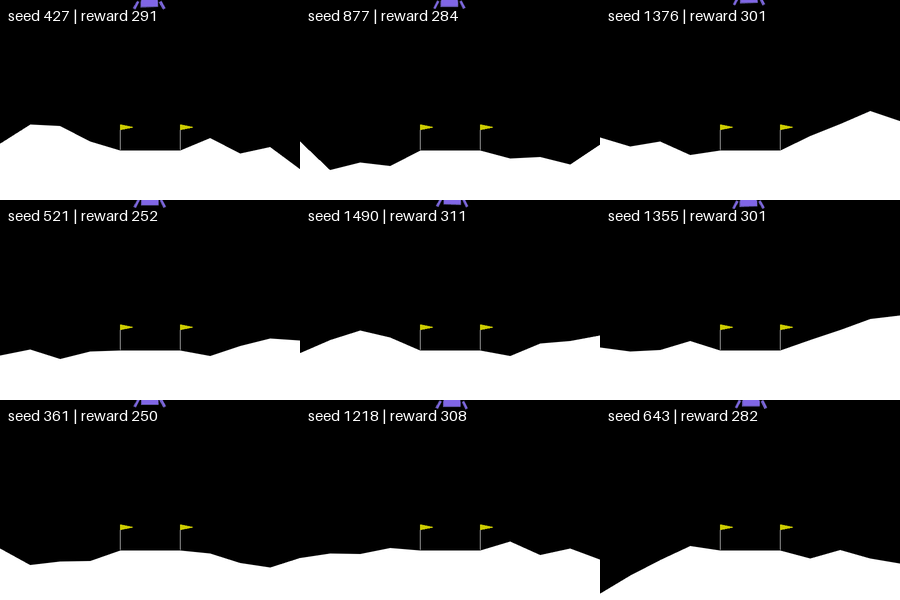
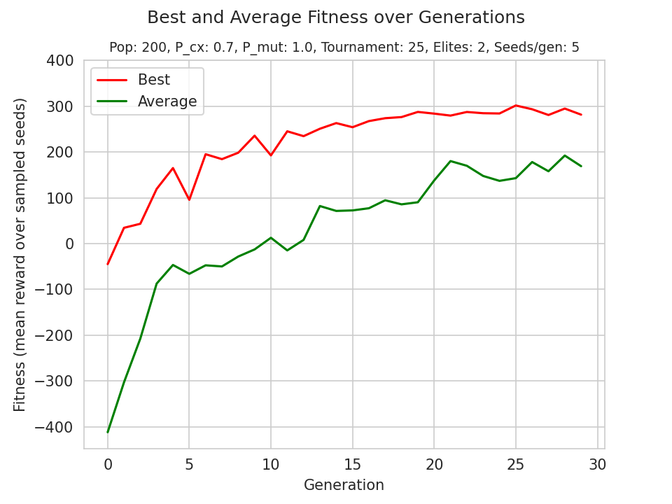

# Neuroevolution Lunar Lander

**A 178-parameter neural network that learns to land with no gradients, only evolution.**



A genetic algorithm evolves the weights of a small neural network to control the continuous version of Gymnasium's [LunarLander-v3](https://gymnasium.farama.org/environments/box2d/lunar_lander/). No backpropagation, no replay buffers, no value functions: just selection, crossover and mutation over a population of candidate pilots.

---

## Results

Evaluated on **100 terrains never seen during training** (seeds 1000–1099):

| Metric | Value |
|---|---|
| Mean reward | **280.6 ± 19.0** |
| Successful landings (reward ≥ 200) | **100%** |
|Worst seed: 750 (238.4) | Best seed: 1020 (320.5)|

Gymnasium considers an episode solved at a reward of 200 or more.



---

## How it works

### The pilot

A multilayer perceptron with one hidden layer:

```
observation (8) → hidden (16, tanh) → action (2, tanh)
```

- **Input:** position, velocity, angle, angular velocity and leg contact.
- **Output:** two continuous values in [-1, 1], the throttle of the main engine and the lateral boosters. The final `tanh` keeps actions inside the environment's action range.
- **Parameters:** 8·16 + 16 + 16·2 + 2 = **178**.

### The genome

Each individual is a flat list of 178 floats. `unflatten()` reshapes it into the network's weight matrices and bias vectors, and `forward()` runs a pure inference pass. **The network never learns. The population does.**

### The evolution

| Component | Choice |
|---|---|
| Population | 200 |
| Generations | 30 |
| Selection | Tournament (size 25) |
| Crossover | Blend crossover (α = 0.5), p = 0.7 |
| Mutation | Gaussian (σ = 0.3, per-gene p = 0.1) |
| Elitism | Top 2 copied unchanged each generation |

### Avoiding memorisation

Training on a single terrain produces a pilot that memorises one path. Instead:

1. **Each generation samples 5 random terrains** from a pool of 158 training seeds, and every individual (elites included) is evaluated on the same 5. Fitness is the mean reward.
2. A **Hall of Fame** keeps the 10 best candidates across all generations.
3. Since those fitness values come from different terrains, the final champion is chosen by **re-evaluating all 10 candidates on the full pool of 158 seeds**.
4. The champion is then tested on **100 unseen seeds**, which is the number reported above.

Evaluation runs in parallel with `multiprocessing`, one environment per process.

---

## Neuroevolution vs. reinforcement learning

Both approaches optimise the same objective: expected episode return. They differ in how they search:

- **Gradient-based RL** (DQN, PPO) explores in *action space* and uses the temporal structure of each episode to assign credit to individual actions.
- **Neuroevolution** explores in *parameter space* and treats each episode as a black box that returns a single score.

Evolution is less sample-efficient, but it needs no gradients, parallelises trivially and copes well with sparse or deceptive rewards. With 178 parameters, it is a natural fit.

---

## Usage

```bash
pip install -r requirements.txt
```

**Train** (saves `best_weights.npy` and a fitness plot):

```bash
python train.py
```

**Watch** the trained pilot:

```bash
python evaluate.py watch --seeds 1000 1001 1002
```

**Test** on unseen terrains:

```bash
python evaluate.py test --n 100
```

**Record** landings as a GIF or video:

```bash
python evaluate.py record --n 6 --grid --cols 3                         # one landing per cell
python evaluate.py record --n 27 --grid --cols 3 --rows 3 --out run.mp4  # 3 landings per cell
```

Pre-trained weights are included, so `watch`, `test` and `record` work without training.

---

## Project structure

```
├── train.py            # genetic algorithm (DEAP)
├── evaluate.py         # watch / record / test modes
├── landing_tools.py    # network architecture and forward pass
├── best_weights.npy    # trained champion
├── results/            # demo GIF and fitness curve
└── requirements.txt
```

---

## Next steps

- Benchmark against **PPO** on the same environment and seeds, comparing episodes needed to reach a reward of 200.
- Compare tournament sizes and mutation strengths.
- Try **CMA-ES** and **NEAT**, which also evolves the network's topology.

---

## License

MIT
